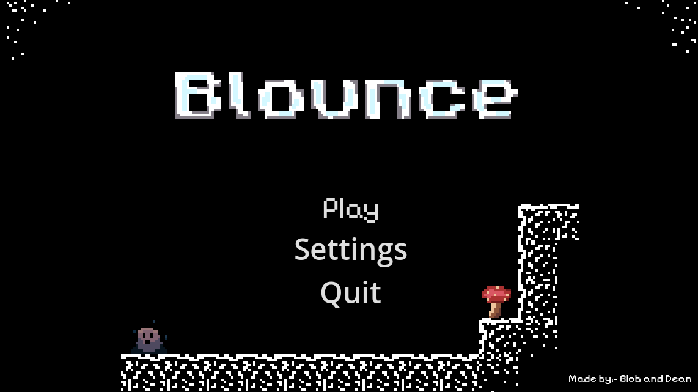
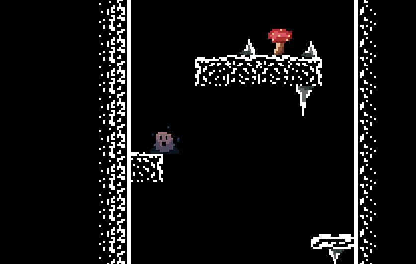

## Blounce 
A 2D platformer rouge-like game in which we have to get out of the hole. 

## DEMO [click here](https://irongolemm.itch.io/blounce)

## Features 
- music slider, mute button, settings menu.
- Main menu with play, settings, and quit buttons.
- Moving platforms which use AnimationPlayer to move.
- Mushroom which give us high jump.
- spikes all over the map so we have to be careful.
- animated Inro.
- Animated Outro with The end.

## Screenshots

## Tech Stack
- Godot 4.5
- godot shaders
- all arts made by [blob](https://github.com/Irongolem222)
- Gd sript
